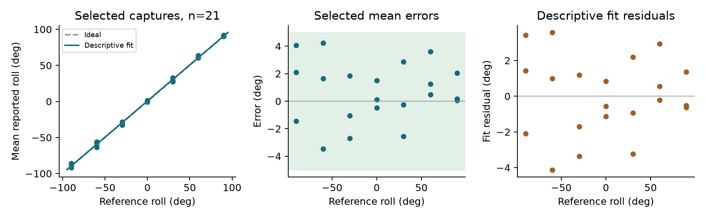
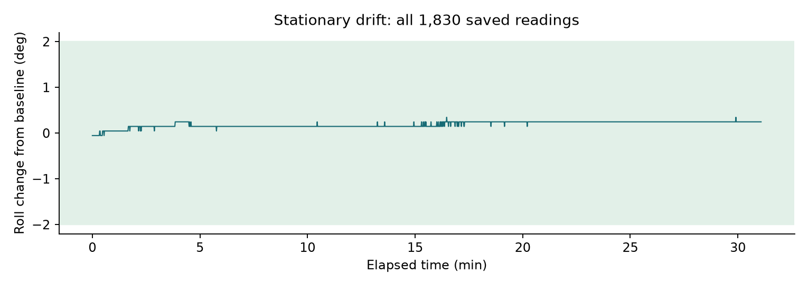
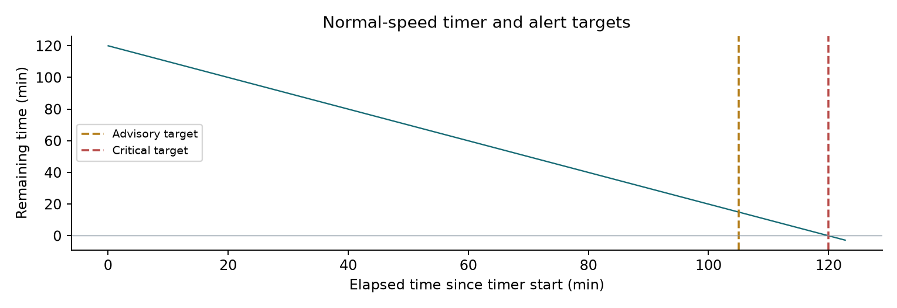
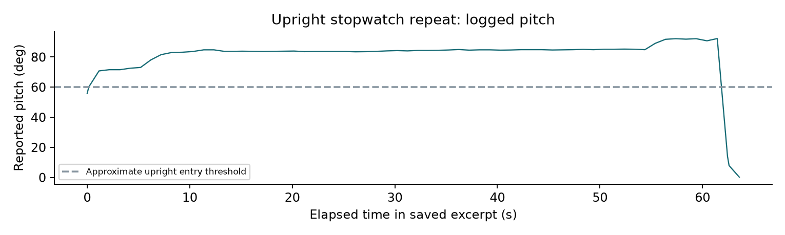

# Verification report

## EXSU 620 | Project 08 | Repositioning patch

**D7 - bench verification, November 7-8, 2026** Prepared for group review. Results describe the tested prototype and retained evidence; no evaluator sign-off has been recorded.

The prototype measures torso orientation, identifies effective turns, issues timed alerts, and records position data. Verification combined independently positioned angle checks, stationary logging, stopwatch observations, video review, and normal-speed and accelerated alarm runs. Tests used a bench sensor assembly, not a patient.

## Overall finding

**Several functions met their numerical targets in the recorded trials. Overall compliance is not established.** Normal-speed advisory and critical timing, a 31-minute drift run, one stopwatch-based upright-duration trial, and one filmed phone-alert bound met the applicable working criteria. Turn recognition and acknowledgement were demonstrated functionally.

The scripted run retained four no-event windows, subsequently classified as invalid executions/dependent returns based on the operator report of interrupted holds, plus obscured reference angles and no recorded start marker. Its schedule comparison is not a validated confusion matrix. Later successful angle repeats and a successful right-turn follow-up do not erase earlier discrepancies. Stillness-based detachment detection remains unverified. Audio was subsequently enabled; IMG_1623 supports button silencing within 0.5 s in one filmed critical-alarm trial.

| Evidence strength | Examples |
|---|---|
| Measured numerical result | Two-hour onset timing; stationary drift; upright stopwatch comparison; filmed critical silencing |
| Observed functional behavior | Effective-turn reset; acknowledgement without timer reset; sensor recovery |
| Not established | Formal sensitivity/specificity; continuous position agreement; all-fault coverage; all-pattern audio repeatability |

The latest selected repeats are shown in the main angle analysis and explicitly identified in the data. Every earlier captured attempt remains in the supporting evidence. A repeated outcome is not relabeled as an original result.

---

# Requirements and traceability

The project card links engineering requirements to CR-1 through CR-4 and requests a 6-10-page D7 report with calibration/residuals, drift, a labelled fault dataset, latency, sensitivity/specificity, and pass/fail findings. The final group D1 and D6 documents were not supplied. The mapping below is a working interpretation of the existing analysis script and prototype settings; reconcile it with the approved D1/D6 before submission.

| Working check / CR | Criterion or behavior | Disposition |
|---|---|---|
| ER-1 / CR-1 | Roll error within +/-5 deg; drift within +/-2 deg | Accuracy unresolved; 31-minute drift trial meets target |
| ER-2 / CR-1 | Position agreement >=95%; exclude first 3 s of each truth interval | Not established: independent truth intervals incomplete |
| Rule definition / CR-2,3 | At least 30 deg change held 15 min; demo hold 15 s | Implemented; thresholds require rationale and independent validation |
| ER-4 / CR-3 | Sensitivity >=95%; no false turns | Conditional sensitivity 16/16 = 100%; independent truth not established |
| ER-5 / CR-2 | Onset error <=5 s; advisory 15 min before 2 h | Recorded demo and normal-speed trials meet target |
| ER-6 / CR-2 | Button silences within 0.5 s | Supported in one filmed critical trial: approximately <=0.3 s |
| ER-7 / CR-1,2 | Fault detected within 60 s | Filmed cable fault meets target; broader fault coverage incomplete |
| ER-8 / CR-4 | Upright duration error within +/-5% | One stopwatch trial: +1.54%; operator-reported reference |

Phone delivery target: within 30 seconds, as used in the preceding project setup. It is not stated numerically in the project card or the supplied analyzer constants; confirm its approved requirement ID and wording. IMG_1611 supports a conservative one-phone bound, not all-alert or all-recipient latency.

This report evaluates the collected trials. It does not alter an acceptance criterion to match a result. Thresholds, sample sizes, evidence limitations, and unmet checks remain visible.

---

# Angle checks and descriptive fit

The sensor was zero-corrected after the operator confirmed a level surface in its intended mounting orientation. Fifteen stationary samples gave raw means of -2.60 deg roll and -3.92 deg pitch. A subsequent ten-sample check averaged +0.07 deg and +0.08 deg, respectively. Zero correction alone does not establish scale accuracy.

The main analysis uses 21 selected angle/trial captures, each summarized from ten readings. They represent seven reference angles and three repositioned trials; the missing independent zero trial was collected later on November 8. There were 32 captured attempts in total. References were operator-set with a protractor and were not independently certified.

Descriptive fit: reported roll = 1.0002 x reference + 0.670 deg; R-squared 0.99875. Residual SD 2.17 deg. This fit was not applied as a new calibration correction. Fit residuals describe agreement with the fitted line, not error from the true angle.

| Reference (deg) | Trial 1 mean | Trial 2 mean | Trial 3 mean |
|---|---|---|---|
| -90 | -91.45* | -85.93 | -87.91* |
| -60 | -58.34* | -63.47 | -55.77 |
| -30 | -32.69* | -31.04 | -28.14 |
| +0 | 1.50 | 0.11 | -0.47 |
| +30 | 29.75* | 27.44* | 32.87 |
| +60 | 63.61* | 61.24* | 60.47 |
| +90 | 90.17 | 90.07 | 92.05 |

* Latest repeat selected; originals retained. Largest selected mean error: 4.23 deg; largest single selected reading error: 4.30 deg. 11 earlier/all captured attempts contained an out-of-tolerance reading. All latest selected captures meet +/-5 deg, but an overall accuracy pass is withheld because the earlier discrepancies and reference setup are unresolved.

---

# Stationary drift and data integrity

The sensor was left stationary on a level surface for an initial 30-minute run. The reference was the first-minute mean; the assessment used all saved healthy readings rather than only the final value. Physical stillness was operator controlled, without a separate motion recording.

| Measure | Recorded result |
|---|---|
| Recorded span | 31.08 minutes; 1,830 samples |
| Baseline / roll range | 0.654 deg / 0.6 to 1.0 deg |
| Largest roll departure | 0.346 deg; target <=2 deg |
| Data integrity | No missing sequences, restarts or sensor faults; max gap 1.055 s |

**Finding: meets the +/-2 deg criterion over the tested 31-minute duration.** This is not evidence for arbitrary longer periods, different temperatures, mounting conditions, or a drift duration not specified in the available plan.

## Logging defect and corrective action

An earlier upright trial had 10-11-second receipt gaps. USB acquisition originally shared the storage path, partial JSON lines could be discarded after timeouts, and database connection contexts did not explicitly close their connections. The fix separated acquisition and persistence, preserved partial lines, closed connections, and added source sequence numbers and monotonic uptime. These changes address plausible delay/loss mechanisms; the exact cause of every earlier gap was not established.

Mock checks covered timeout-split records and transient database errors. A subsequent 65-second run had zero missing sequences and a maximum gap of 1.052 s. The later two-hour run also had no missing sequences. No readings were synthesized to fill gaps. An earlier browser USB-port conflict was resolved separately by releasing Chrome serial access.

---

# Scripted turn protocol

IMG_1615 is a 26-minute-4-second recording of the 46-step protocol. The saved armed window spans 26.8 minutes and includes 1,608 samples, no missing sequences or restarts, and four brief faulted samples. The video was reviewed using a timeline storyboard and early/middle/late views for each planned step. This is not frame-by-frame certification of every reference angle or dwell.

| Planned-schedule comparison | Recorded count |
|---|---|
| Lateral/return turn steps containing a turn event | 16 of 20 |
| Excluded invalid/dependent steps (operator report) | 3, 4, 11, 12 |
| Partial/no-turn steps containing a turn event | 0 of 23 |
| Upright steps containing an upright-turn event | 3 of 3 |
| Total logged turns / partials / position events | 19 / 5 / 34 |

**These are diagnostic schedule counts, not validated sensitivity, specificity, or false-turn rates.** A provisional four-second guide offset and five-second event tolerance were used. Offsets from zero to eight seconds gave the same counts, but this robustness does not prove synchronization. No physical press marker was recorded; the guide timer was not framed, and some protractor markings were obscured.

The operator later reported interrupted holds. Steps 3 and 11 are classified as invalid executions on that basis, and steps 4 and 12 are excluded as dependent returns after qualifying turns were not established. This is an operator-reported explanation, not an independently confirmed video cause. The four original no-event windows remain in the evidence. Device-reported roll was about 17-25 deg during the two intended holds; that does not independently establish the physical angle.

## Targeted follow-up and interpretation

IMG_1616 shows repeated hand-held adjustments followed by a steadier inclined hold. The log contains an interrupted candidate and a later lateral turn at reported roll 40.1 deg, with the timer resetting to 119.9 s. The protractor baseline was not fixed level, so this demonstrates functional recognition but does not independently validate an exact 40-deg angle or retroactively replace missing events in IMG_1615.

Conditional observed sensitivity = 16/16 = 100%, after excluding the four documented invalid/dependent executions. This arithmetic estimate assumes every retained trial was a true qualifying turn. That assumption is not independently verified for every angle/dwell interval, so verified sensitivity and closure of the >=95% requirement remain unestablished. No turn events occurred in the 23 planned partial/no-turn steps, but specificity is likewise not independently validated. Exclusions are not passes.

---

# Alarm timing and phone delivery

Timing was assessed from device monotonic uptime. Demo mode compresses a two-hour interval to 120 s; normal mode uses 7,200 s. The normal timer origin was inferred from the first healthy normal-speed sample and its remaining-time field, rounded to 0.1 s. No upright intervals or effective turns interrupted that normal-speed run.

| Mode / alert | Target | Recorded elapsed | Finding |
|---|---|---|---|
| Demo advisory | 105 s | 104.958 s | Within +/-5 s |
| Demo critical | 120 s | 119.974 s | Within +/-5 s |
| Normal advisory | 6,300 s | ~6,300.0 s | Within +/-5 s |
| Normal critical | 7,200 s | ~7,200.0 s | Within +/-5 s |

The normal-speed record contained 7,266 samples across about 2 h 2 min 44 s, with zero missing sequences, source restarts, sensor faults, or upright samples. Maximum receipt gap was 1.056 s. The operator confirmed receipt of both normal-speed alerts and both demo alerts; those confirmations establish functional receipt, not exact phone arrival timing.

## Filmed technical-alert arrival

IMG_1611 shows a new "Bed patch: check the patch" message appearing on the receiving phone. The sensor was clearly connected at video time 11.977 s, and the new message was clearly readable by 28.990 s. Because unplugging occurred after the connected frame, 17.02 s is a conservative upper bound for this trial. It is not an exact measured latency. The filmed Telegram chat was open; lock-screen notification behavior was not tested.

The matching API responses were successful for two recipient IDs about 0.36-0.37 s after the server fault event. API response time is not phone delivery time; only one phone is visually verified. The 30-second working delivery target is supported for this filmed technical-alert trial, subject to confirming its approved requirement wording.

---

# Fault dataset and acknowledgement

The labelled fault evidence covers sensor-cable disconnection. The physical onset/reconnect times in the early operator-message trials were not independently timestamped. Their device-reported fault onset is not a substitute for the physical fault instant. Later video supports a visible detection bound.

| Dataset item | Fault / observed response | Limitation |
|---|---|---|
| Monitored cycle 1 | Cable unplug; technical event; recovered with technical_clear | Physical onset time not recorded |
| Monitored cycle 2 | New technical event and later technical_clear | Record window also contains other handling/events |
| Monitored cycle 3 | Technical event; subsequent healthy normal readings | Recovery event absent from saved log |
| IMG_1603 | Power loss near 5 s; cyan visible near 10 s; green after reconnect | Approx. 4.5-5.5 s visible response; partly obscured contacts |
| IMG_1608 / IMG_1611 | Technical event, successful API responses, technical_clear | Phone timing supported only by the IMG_1611 bound |

**Finding: the filmed cable-disconnection response is within the 60-second working detection target for that trial.** Multiple recoveries were demonstrated. The earlier missing technical_clear remains a retained logging finding; subsequent successful recovery records do not establish its specific cause.

## Coverage gaps

Stillness detection is disabled (STILL_RANGE = 0.00). Motionless/removed-patch detection cannot be marked passed. The four faulted samples during the scripted run are retained as device fault flags, not relabelled as deliberately injected faults. Calibration-loss coverage was not established.

## Button and audible behavior

A button press during a critical state generated an ack event, set acked=true, and left the timer overdue. A later effective turn generated turn and critical_clear events and restarted the timer. In the targeted follow-up, the critical state remained latched at the turn; the evidence does not imply every turn clears an unacknowledged alarm.

Earlier tests used silent mode. Audio was subsequently enabled. The operator separately confirmed all three patterns and button silencing; advisory and critical output were also filmed. In IMG_1623, the final visible firm depression occurs at approximately 29.80-29.90 s; the final tone and decay end by 30.035 s. Allowing for frame quantization, the observed response is conservatively approximately 0.3 s or less, supporting the <=0.5 s criterion in this one critical-alarm trial. This is a video-based bound, not calibrated electrical latency or a repeatability result. The technical pattern remains operator-confirmed rather than independently filmed.

---

# Upright detection and duration

The first timed hold demonstrated upright classification but had logging gaps and mismatched cue/stopwatch boundaries. It was not accepted as a duration-accuracy test. After the logging correction, a repeated hold had continuous sequence numbers. An initial 62-second operator observation was compared with a full 88.774-second logged interval, revealing that the stopwatch and logging windows did not coincide; that comparison was retained, not treated as a pass.

| Independent stopwatch repeat | Result |
|---|---|
| Operator-reported elapsed time | 61.49 s |
| Full logged upright entry-to-exit interval | 62.437 s |
| Difference / relative error | +0.947 s / +1.54% |
| Acceptance / continuity | Within +/-5%; no missing sequences; max gap 1.052 s |

**Finding: one stopwatch-based repeat meets the +/-5% numerical criterion.** The operator started timing during the move upright and stopped during return flat. Physical movement and device classification thresholds can differ; no video of this duration repeat was saved. The reference is therefore explicitly operator reported.

The full protocol video also shows gross upright holds, but it was not independently annotated to provide a complete video-derived upright-duration reference. This report does not claim a second independent accuracy result from those planned hold lengths.

The demonstrated interval is upright posture of a bench-mounted sensor, not proof of actual mobilisation or time out of bed in a patient. CR-4 also calls for per-shift audit records. Persistence exists in the service; complete end-to-end shift-summary audit accuracy was not separately validated in this session.

---

# Disposition and evidence index

The prototype demonstrated sustained logging, working alert timing, phone receipt, acknowledgement, turn timer reset, and recovery from a disconnected sensor. Numerical passes are limited to the recorded conditions. Formal position agreement and sensitivity/specificity remain unissued because independently scored angle/dwell truth and exact synchronization were not established for all protocol steps.

| Evidence group | Primary record |
|---|---|
| Angle checks and complete attempt history | roll_accuracy_results.md; selected_angle_measurements.csv; all_angle_attempts.csv |
| Drift / logging correction | drift_result_20261107_220745.json; logging_continuity_summary.json |
| Demo / normal timing | alarm_timing_20261107_213357.json; normal_run_result_20261108_004933.json |
| Upright repeat | upright_stopwatch_repeat_20261107_213158.json |
| Full protocol / follow-up | protocol_1615_review.md; protocol_completed_20261108_153647.json; video_review_IMG_1616.md |
| Fault / phone video reviews | video_review_IMG_1603.md; video_review_IMG_1608.md; video_review_IMG_1611.md |

## Before submission

1. Reconcile working IDs and criteria with the final D1 requirements and D6 verification plan, including sample sizes, reference apparatus and named sign-off. No engineering requirement should be silently weakened after testing.

2. Preserve earlier angle discrepancies and aborted runs. Document a demonstrable setup cause before excluding an attempt; successful repeats alone do not justify exclusion. If exact-angle performance is to be closed, use a secured level reference and independently reviewable readings.

3. For ER-2/ER-4, establish an independent truth dataset from adequate video evidence or perform the necessary targeted repeats. Do not replace observed truth with the planned schedule. Report not established when evidence cannot support a pass/fail performance estimate.

4. Retain the historical silent-mode configuration and subsequent audio verification in the record. Resolve or explicitly report disabled stillness detection. Explain the Telegram substitution in the design rationale because the supplied card lists other messaging options. Preserve opt-in records and keep bot tokens out of submission files.

## Source and provenance

Source documents: EXSU620_Project08_Repositioning_Card.pdf, pp. 1-8; project analysis/analyze.py acceptance constants; deployed firmware/service and captured JSON records. Figures were regenerated from retained measurements, not simulated outcomes. Supporting files include an evidence manifest with SHA-256 hashes; original videos remain at their supplied local paths and are not embedded in the evidence ZIP.

**Final status: verification report prepared; overall project compliance and evaluator sign-off remain open.** Hands-on testing ended by the operator's decision. No failed or unverified result has been promoted to a pass.
